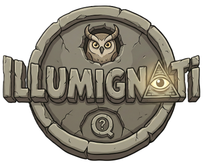
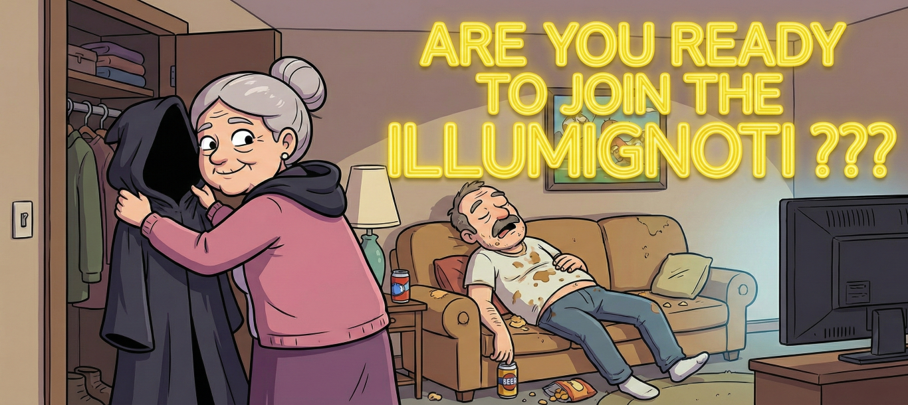
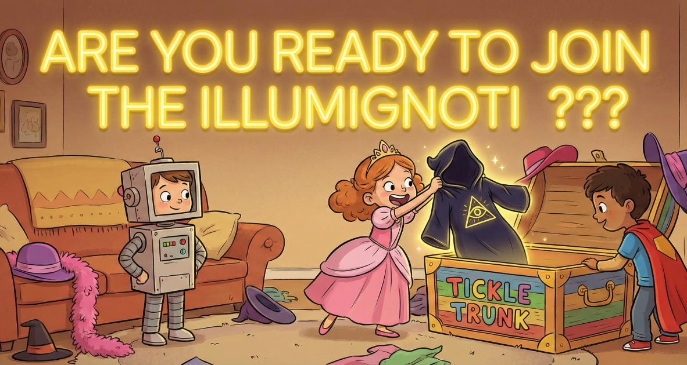
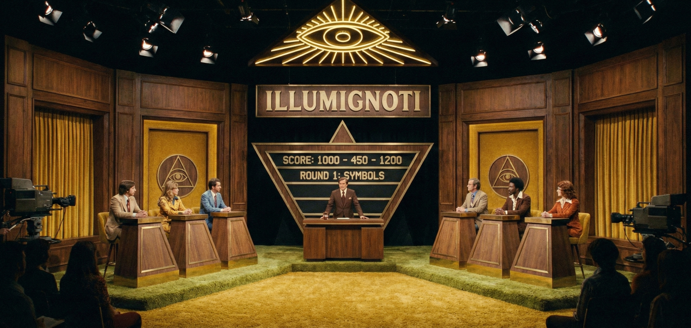
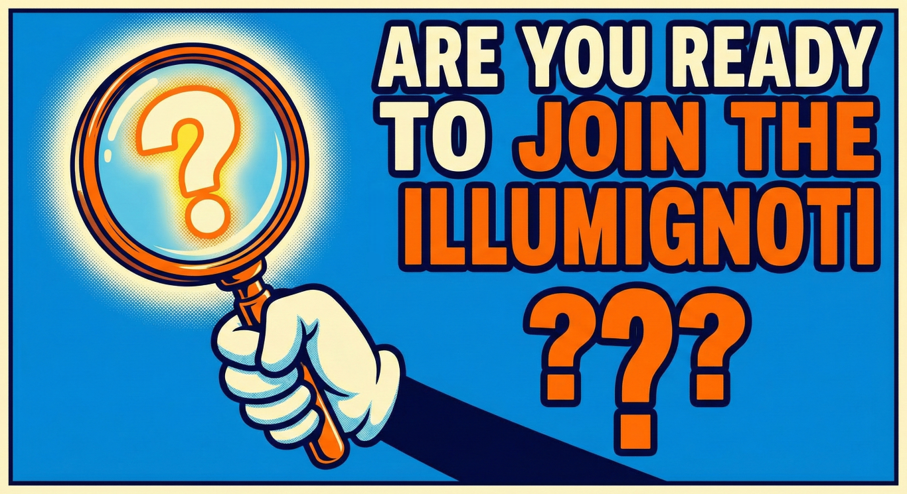
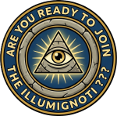
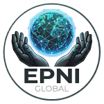
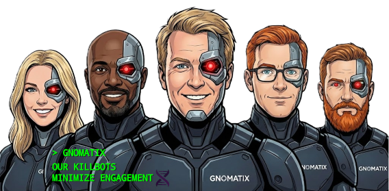
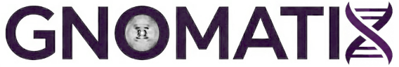

# 

> 🧠 **The ultimate decentralized trivia battleground.** Test your knowledge, outsmart your peers, rise in the ranks, and take on "experts" from all over the world!

## Why "Illumignoti"?

The name is a conceptual portmanteau combining **"illuminate"** (to bring light or understanding), **"mignon"** (darling or favored), and **"gnosis"** (knowledge). It serves as an intentional play on the word "illuminati"—reflecting the platform's global, shadowy, yet ultimately enlightening peer-to-peer nature.

---

---

## Ethical Manifesto: Privacy & Gamified Expertise

**Illumignoti fundamentally respects, values, and is architecturally designed to ensure absolute user privacy and anonymity.**

This is a **game ecosystem**, and our engine logic dictates that any and all credentials the user provides are strictly **opt-in**. While you can play and interact completely pseudonymously forever, users who wish to identify themselves as "putative experts" can link verifiable external accounts (like ORCiD, LinkedIn, Google Scholar, etc.). 

Doing so is simply a way to make the experience **more fun and personal**, opening up additional tier-based gaming features, matchmaker priority, and proactive "Stump the Expert" outreach. Anyone can do this. 

If the platform doesn't currently support an open authentication protocol that allows you to "self-identify" in your specific field, please contact the developers and we'll work to include it!

**Total Control:** You can also "opt-out" of anything at any time. For example, if you are a retired lawyer who only wants to answer questions about aviation and explicitly *never* anything related to law, the ontology system allows you to configure your node routing precisely to your liking.

*(Note: To ensure the systemic integrity of the platform against automated gamification, the exact mathematical routing algorithms and trust multipliers are kept hidden in proprietary modules, but the open-source client and networking stack are fully auditable.)*

---

---

## World-Wide Quiz Fun

Illumignoti is a platform that allows users to participate in a world-wide trivia "Quiz Show" utilizing a dynamic, JSON-schema driven engine that supports infinite game variations:

- Classic Multiple Choice
- Time-gated Jeopardy style
- Free-text "Fill in the blank"
- $10,000 Pyramid definitions
- User-authored "Stump the Experts" content

All of the quizzes are categorized using a standard ontology/controlled vocabulary of knowledge areas, allowing you to curate exactly what you want to play.

---

---

## Implementation Architecture

Illumignoti is built on **[Pear](https://github.com/holepunchto/pear)**.

By utilizing Holepunch's Hypercore and Hyperswarm, the platform achieves zero-config, serverless, peer-to-peer matchmaking.
- **Language:** JavaScript / Node.js
- **Persistence:** Local SQLite databases for host-side state and verifiable log tracking
- **UI:** Terminal User Interface (TUI) optimized for rapid interaction

### Are you ready to join... The Illumignoti?
---

---

## Our Valued Global Partners

| **YOU** | EPNI | ITVB | IOA |
| :----: | :----: | :----: | :----: |
|  |  |  |  |

---

## License: Business Source License (BSL)
Copyright © 2026 GNOMATIX. All rights reserved.

This software is licensed under the Business Source License (BSL) version 1.1. Usage of this software is subject to the terms of the BSL. See the LICENSE file for details.

